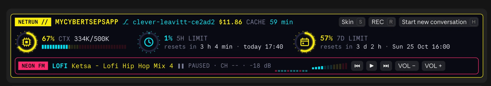
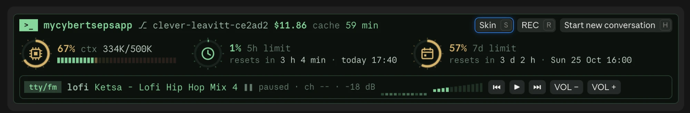
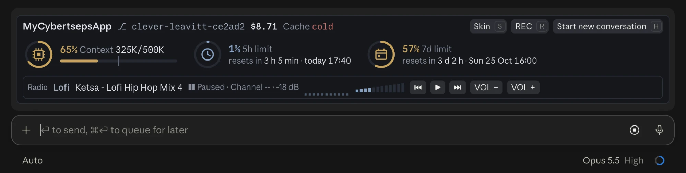

# claude-mods

Mods for Claude Code.

## session-band

A band above the prompt that shows, at a glance:

- the project, branch, session cost and how long the prompt cache stays warm;
- context fill against the auto-compact point, with a segmented buffer bar;
- the 5-hour and 7-day usage limits with their reset times (account-wide: a session that has no reading yet shows the last one any session saw, until that window resets);
- **REC**: masks e-mails, IPs, tokens, passwords and your login on screen while you record or share it (`/rec on|off|add <word>|remove <word>|list`);
- **New chat**: asks Claude to write a handoff note to `~/.claude/handoffs/` and puts the prompt for the next conversation on the clipboard;
- a radio strip for [cliamp](https://github.com/bjarneo/cliamp): play/pause, previous, next, volume.

### Skins

Three skins, switched live with the **◐** button in the band (hotkey `s`) or `/skin [neon|hacker|pro|list]`. The choice is remembered between sessions.

**neon**



**hacker**



**pro**



### Install

At the prompt of a terminal session:

```
/plugin install session-band --marketplace przemokam/claude-mods
```

Answer `y` to add the marketplace, then choose a scope.

From a shell:

```bash
claude plugin install session-band --marketplace przemokam/claude-mods
```

In the desktop app, where `/plugin` does not run: click + next to the prompt box, then Plugins, Add marketplace with `przemokam/claude-mods`, then Add plugin.

### Notes

- The radio expects cliamp at `/opt/homebrew/bin/cliamp` (`brew install bjarneo/cliamp/cliamp`); without it the strip stays offline and everything else works.
- The context gauge counts against 500K tokens (`COMPACT_AT` in `hooks/register.tsx`); keep it in step with `autoCompactWindow` in your `~/.claude/settings.json`.
- Tests: `claude plugin test session-band`.

## License

MIT
